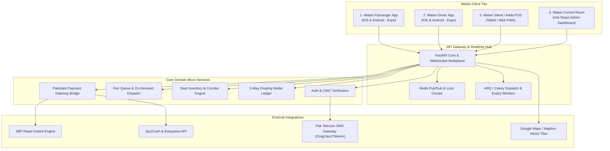
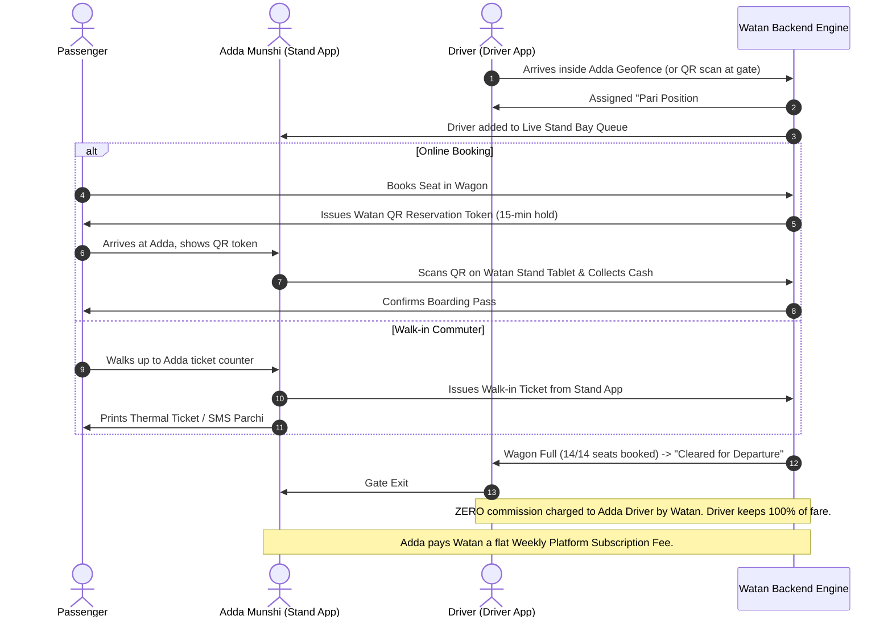

# Watan (وطن) — Production Architecture & Engineering Blueprint
**National Multi-Modal Ride-Hailing, Adda Management & Inter-Corridor Transport Platform for Pakistan**

---

## 1. Executive Vision & The "Adda" Disruption

### 1.1 The Market Paradox
Ride-hailing giants like Uber, Careem, and Indrive captured tier-1 private car and bike on-demand markets in Pakistan, but they completely bypassed the bedrock of Pakistani public transport: **The Adda (اڈہ) System**.

In Pakistan:
- Over **70% of daily intercity and peri-urban passenger trips** originate at physical stands (*Addas*), managed by Adda managers (*Thekedars* / *Munshis*).
- Millions rely on non-car transport: **Qingqis** (Chingchi 6-to-9-seater rickshaws), **Auto-Rickshaws**, **Motorcycles** (Bykea model), **HiAce Wagons**, **Carry Dabhas**, and **Coaster Buses**.
- At every Adda, drivers wait in a turn-based queue called **"Pari" (پاری)**, and the Adda manager issues a paper slip called a **"Parchi" (پرچی)**, deducting a stand fee per trip.

### 1.2 The Watan Solution
**Watan (وطن)** does not attempt to destroy the Adda system; it **co-opts, empowers, and digitizes it**.

```
                +-------------------------------------------------------+
                |                    WATAN PLATFORM                     |
                |          (National Mobility Umbrella & Clearing)       |
                +-------------------------------------------------------+
                                   |                 |
                +------------------+                 +------------------+
                |                                                       |
        [ ON-DEMAND ROAMING ]                                   [ ADDA / STAND NETWORK ]
  Doorstep point-to-point hailing                        Physical hubs, fixed corridors, terminals
  • Bike (Motorcycle)                                    • Digitized Adda Manager Tablet (POS / Pari)
  • Auto-Rickshaw (3-wheeler)                            • Co-branded Stands (e.g. "Al-Madina Adda - Watan")
  • Qingqi (Private Charter)                             • Scheduled & On-Fill Departures
  • Car Mini / Car Comfort                               • Per-Seat Booking or Whole Vehicle
  • Cash / JazzCash / Easypaisa                          • "Reserve Now, Pay Cash at Stand Counter"
```

---

## 2. Platform Architecture & Ecosystem Applications

The platform consists of **Four Specialized Frontends** unified by a **Modular Realtime FastAPI Backend**:



---

## 3. Vehicle Classes & Service Modalities

| Vehicle Class | Capacity | Booking Mode | Pricing Engine | Typical Vehicle Models |
| :--- | :--- | :--- | :--- | :--- |
| **Watan Bike** | 1 Pax | On-Demand (Doorstep) | Base + Per KM + Per Min | Honda CD70, CG125, Yamaha YBR |
| **Watan Rickshaw** | 3 Pax | On-Demand (Doorstep) | Base + Per KM | Sazgar, Piaggio, Qingqi 3-wheeler |
| **Watan Qingqi (Chingchi)** | 6–9 Pax | Per-Seat Shuttle or Private Charter | Stage-wise Corridor Fixed Fare or On-Demand | 6-seater / 9-seater motorcycle puller |
| **Watan Mini** | 4 Pax | On-Demand (Doorstep) | Dynamic Base + KM + Time | Suzuki Mehran, Alto, Cultus, WagonR |
| **Watan Comfort** | 4 Pax | On-Demand (Doorstep) | Dynamic Base + KM + Time | Toyota Corolla, Yaris, Honda City |
| **Watan Wagon** | 11–15 Pax | Per-Seat or Full Hire (Adda Based) | Fixed Route Stage Fare or Private Package | Toyota HiAce, Suzuki Bolan (Carry Dabba), Changan Karvaan |
| **Watan Coaster** | 22–30 Pax | Per-Seat Terminal Shuttle | Intercity / Inter-district Fixed Schedule | Toyota Coaster, Hino Bus |

---

## 4. The "Adda" & "Pari" Operational Engine

### 4.1 Understanding the Traditional Adda Workflow
1. **Stand Ownership**: Addas are operated by a Stand Contractor (*Thekedar*) with a Stand Manager (*Munshi*).
2. **Pari (Turn System)**: Drivers arrive at the Adda. The Munshi puts them in a strict first-in, first-out (FIFO) queue ("Pari"). Driver #1 loads passengers first.
3. **Parchi (Receipt/Commission)**: For every trip departing the stand, the driver pays the Munshi a fixed "Parchi" fee (e.g., PKR 100 to PKR 300 per trip).
4. **Walk-in Passengers**: Commuters arrive on foot, purchase a token or board the next loading vehicle.

### 4.2 The Watan Digital Transformation


### 4.3 Algorithmic Pari (Queue) Priority Rules
The digital Pari queue is managed by `services/pari_engine.py`:
- **Strict FIFO**: Vehicles line up based on validated arrival timestamp.
- **Priority Modifiers**:
  - Punctuality Score (bonus queue jump if driver arrived on schedule).
  - Cleanliness & Safety Inspection status (passed weekly Adda check).
  - Zero-Show Penalty (if a driver declines a loading turn, pushed to back of Pari).
- **Departure Conditions**:
  - `CAPACITY_REACHED`: All designated seats (e.g., 14/14) are occupied.
  - `SCHEDULE_TRIGGER`: Pre-set departure time arrived (e.g., 08:30 AM), vehicle departs with partial fill.

### 4.4 The "Hybrid Captain": Seamless Switching Between Independent & Adda Modes

In Pakistan's reality, many drivers (especially Suzuki Bolan, Rickshaws, and Mehran/Alto cars) operate with maximum flexibility: they run fixed intercity/corridor routes out of an Adda during morning rush hours, and then roam commercial centers picking up doorstep hail rides like an Uber driver in the afternoon.

#### A. Fleet Rostering (Adda Munshi Control)
- **Adda Owner Responsibility**: Each Adda Manager has complete authority to manage their own fleet roster via the **Watan Stand App**.
- **Driver Affiliation**:
  1. An independent driver can be added by the Munshi scanning the driver's Watan Driver ID QR code, or searching their CNIC/Phone number.
  2. Once approved, the driver has an active membership record: `adda_memberships: [{ adda_id: "...", status: "active" }]`.
  3. Drivers can be affiliated with one or more Addas, or none at all (purely independent).

#### B. Geofence Detection & Automated Mode Transition
Watan utilizes intelligent background geofencing via `expo-location`:

```
               [ Driver in City (Independent Roaming Mode) ]
               • On-demand doorstep ride offers
               • Dynamic map with heatmaps
               • 10% platform commission via wallet float
                                    │
                     Driver drives into Adda Geofence
                     (e.g. within 150m of Pirwadhai Stand)
                                    │
                                    ▼
               ┌───────────────────────────────────────────┐
               │  📍 GEOFENCE PROMPT (Bottom Sheet Modal)  │
               │  "You have arrived at Al-Makkah Adda.     │
               │   Join the live Pari queue?"              │
               │                                           │
               │   [ Join Adda Mode ]   [ Stay Freelance ] │
               └────────────────────┬──────────────────────┘
                                    │ (Driver taps "Join")
                                    ▼
               [ Driver Switched to Adda Mode ]
               • UI transforms immediately into Adda Monitor
               • Shows: Live Pari Turn #, Bay #, Seat Manifest
               • On-demand doorstep hails are paused
               • 0% Watan Commission (covered by Adda weekly plan)
```

#### C. Anti-Abuse & State Collision Guardrails
To prevent operational conflicts and commission evasion:
1. **No Concurrent States**: A driver cannot be on an active doorstep ride while simultaneously occupying a slot in the Adda Pari queue. Entering Adda Mode automatically suspends on-demand matchmaking.
2. **Geofenced Verification**: A driver cannot toggle into "Adda Mode" (0% commission) while physically miles away from the stand in an attempt to dodge freelance commissions.
3. **Graceful Exit**: When a driver completes an Adda trip or departs the stand geofence, a persistent prompt asks: *"Leaving Adda? Tap to switch back to Independent Roaming Mode"*.

---

## 5. Pakistani Payment Infrastructure & Financial Model

### 5.1 The Two-Tier Monetization Architecture

Watan operates on two distinct, crystal-clear financial engines:

```
                          ┌─────────────────────────────────────┐
                          │     WATAN MONETIZATION ENGINE       │
                          └──────────────────┬──────────────────┘
                                             │
             ┌───────────────────────────────┴───────────────────────────────┐
             ▼                                                               ▼
  [ ADDA / STAND FLEET ]                                          [ INDEPENDENT ROAMING FLEET ]
  (HiAce Wagons, Qingqis, Stand Cabs)                             (Freelance Bikes, Rickshaws, Cars)
  • ZERO Commission on Drivers                                    • Per-Trip Commission (e.g. 10%)
  • Driver keeps 100% of seat/trip fares                          • Floating Prepaid Driver Wallet
  • Adda Owner pays Watan a WEEKLY PLATFORM FEE                   • Deducted automatically per cash ride
  • (e.g., Rs. 2,000 – Rs. 7,000/week flat)                       • Negative balance threshold: -Rs. 1,500
  • Zero cash friction at the counter                             • Top up via Raast / JazzCash / Easypaisa
```

#### A. Adda Ecosystem (B2B Weekly Subscription — 0% Driver Commission)
- **Zero Driver Deductions**: Drivers registered under an Adda are **never charged per-trip commission by Watan**. They keep 100% of their passenger fares or settle their traditional local stand parchi with their Munshi as usual.
- **Weekly Adda Subscription**: Watan bills the Adda management a fixed **weekly software & listing fee** (e.g., PKR 3,000 to PKR 10,000/week based on bay/fleet tier).
- **Why this dominates in Pakistan**:
  1. *Frictionless Driver Onboarding*: Drivers don't have to recharge wallets, worry about balances, or fear digital deductions.
  2. *Adda Owner Alliance*: Adda owners become Watan's strongest champions because their drivers are happy and the stand gets modernized with seat booking software for a predictable flat weekly cost.
  3. *Zero Reconciliation Headaches*: Watan does not have to track or chase thousands of daily micro-cash payments across noisy transport stands. The Adda pays its invoice once a week via Raast / 1Link / JazzCash.

#### B. Independent Roaming Fleet (P2P Ride-Hailing Float)
- For independent roaming drivers (doorstep bikes, rickshaws, and private cars not attached to any Adda), commission (e.g., 10%) is deducted from their **Prepaid Floating Wallet**.
- Drivers can run up to **-PKR 1,500 negative float** before being temporarily locked until recharged via Raast QR, JazzCash, or Easypaisa.

### 5.2 Pakistani Payment Rails Integration Architecture

```
                    +------------------------------------+
                    |       Watan Payments Gateway       |
                    +------------------------------------+
                                      |
         +----------------------------+----------------------------+
         |                            |                            |
  [ State Bank Raast ]       [ JazzCash / Easypaisa ]     [ 1Link 1Bill / Cards ]
  • SBP Instant P2M          • Direct Mobile Account      • 1Link 1Bill PSID Generation
  • EMVCo Dynamic QR Code      Debit (USSD push prompt)   • PayFast / Bank Alfalah APG
  • Zero MDR Interchange     • Open API Web Checkout      • PayPak / Visa / Mastercard
  • Real-time Bank-to-Bank   • Over-The-Counter (OTC)     • ATM & Online Banking Top-Up
```

---

## 6. Database Schema Design (MongoDB)

### 6.1 `addas` Collection (Stands & Terminals)
```json
{
  "_id": "adda_rawalpindi_pirwadhai_01",
  "name": "Al-Makkah Wagon Stand",
  "watan_code": "ISB-RAW-001",
  "city": "Rawalpindi",
  "district": "Rawalpindi",
  "location": {
    "type": "Point",
    "coordinates": [73.0479, 33.6261]
  },
  "geofence_polygon": {
    "type": "Polygon",
    "coordinates": [[[73.046, 33.625], [73.050, 33.625], [73.050, 33.628], [73.046, 33.628], [73.046, 33.625]]]
  },
  "manager_user_id": "user_munshi_9918",
  "allowed_vehicle_types": ["wagon", "qingqi", "coaster"],
  "bays_count": 8,
  "internal_parchi_rate_fixed_pkr": 150.0,
  "driver_watan_commission_percent": 0.0,
  "weekly_subscription_fee_pkr": 4500.0,
  "subscription_status": "active",
  "billing_cycle": "weekly",
  "next_billing_due": "2026-10-25T00:00:00Z",
  "status": "active",
  "created_at": "2026-10-18T20:00:00Z"
}
```

### 6.2 `pari_queues` Collection (Stand Live Turn Rotation)
```json
{
  "_id": "pari_pirwadhai_route_04",
  "adda_id": "adda_rawalpindi_pirwadhai_01",
  "corridor_id": "route_rawalpindi_to_peshawar",
  "queue": [
    {
      "driver_id": "driver_3819",
      "vehicle_id": "veh_hiace_992",
      "plate_number": "LES-19-4821",
      "pari_position": 1,
      "status": "loading",
      "bay_number": 2,
      "total_seats": 14,
      "booked_seats_count": 11,
      "scheduled_departure": "2026-10-18T20:45:00Z",
      "arrived_at": "2026-10-18T19:50:00Z"
    },
    {
      "driver_id": "driver_5541",
      "vehicle_id": "veh_hiace_104",
      "plate_number": "ICT-21-7712",
      "pari_position": 2,
      "status": "waiting_in_bay",
      "bay_number": 3,
      "total_seats": 14,
      "booked_seats_count": 0,
      "arrived_at": "2026-10-18T20:10:00Z"
    }
  ],
  "updated_at": "2026-10-18T20:15:00Z"
}
```

### 6.3 `seat_bookings` Collection (Corridor & Adda Seats)
```json
{
  "_id": "seat_bkg_98213",
  "booking_code": "WTN-PK-8912",
  "passenger_id": "user_pax_4421",
  "passenger_phone": "+923001234567",
  "adda_id": "adda_rawalpindi_pirwadhai_01",
  "driver_id": "driver_3819",
  "vehicle_id": "veh_hiace_992",
  "corridor_id": "route_rawalpindi_to_peshawar",
  "seats_reserved": [3, 4],
  "fare_per_seat_pkr": 450.0,
  "total_fare_pkr": 900.0,
  "payment_mode": "pay_at_adda",
  "payment_status": "unpaid",
  "booking_status": "reserved",
  "reservation_expires_at": "2026-10-18T20:35:00Z",
  "ticket_qr_hash": "sha256_verification_string",
  "created_at": "2026-10-18T20:00:00Z"
}
```

### 6.4 `wallet_ledger` Collection (Financial Accounting)
```json
{
  "_id": "tx_ledger_104928",
  "entity_type": "driver",
  "entity_id": "driver_3819",
  "trip_id": "trip_98213",
  "type": "debit_commission",
  "amount_pkr": 120.0,
  "previous_balance_pkr": 850.0,
  "new_balance_pkr": 730.0,
  "reference_type": "trip_parchi_watan_split",
  "description": "Watan platform fee for completed Rawalpindi-Peshawar trip",
  "created_at": "2026-10-18T21:30:00Z"
}
```

### 6.5 `drivers` Collection (Dual-Mode Hybrid Profile)
```json
{
  "_id": "driver_3819",
  "name": "Tariq Mahmood",
  "phone": "+923121234567",
  "cnic": "37405-1234567-1",
  "vehicle_class": "wagon",
  "vehicle_plate": "LES-19-4821",
  "active_mode": "adda",
  "current_adda_id": "adda_rawalpindi_pirwadhai_01",
  "pari_position": 2,
  "geofence_status": "inside_adda",
  "adda_memberships": [
    {
      "adda_id": "adda_rawalpindi_pirwadhai_01",
      "status": "approved",
      "enrolled_by_munshi_id": "user_munshi_9918",
      "joined_at": "2026-09-15T10:00:00Z"
    }
  ],
  "floating_wallet_balance_pkr": 420.0,
  "credit_limit_pkr": -1500.0,
  "is_online": true,
  "updated_at": "2026-10-18T20:25:00Z"
}
```

---

## 7. Comprehensive Stitch UI Design Specifications & Prompts

Use these prompt commands directly in **Stitch** to generate production-grade screens:

### Design Tokens:
- Emerald Green (`#006837`), Gold Accent (`#FFB800`), Slate (`#0F172A`), Off-white (`#F8FAFC`).
- High-contrast, Urdu-capable layouts.

---

### 🎨 Stitch Prompt 1: Watan Passenger Home (Multi-Modal & Adda Explorer)

```text
Create a modern, ultra-premium mobile app screen for "Watan" (Pakistan's national transport super-app), designed in Flutter / React Native style.
Top Bar:
- Clean header with location selector: "Islamabad / Rawalpindi", current neighborhood "Saddar, Rawalpindi" with GPS pin.
- Right side: Wallet balance chip ("Rs. 450") and User Avatar.
- Language toggle switch: [English | اردو].

Hero Carousel:
- Dynamic banner: "Book any ride or reserve an Adda seat across Pakistan".
- Search Bar with floating shadow: "Where to? (کہاں جانا ہے؟)" with microphone icon for Urdu voice search.

Vehicle Mode Grid (Horizontal Scroll / 2-Row Modern Grid):
- "Bike" (Motorcycle icon, starting Rs. 80, fast doorstep)
- "Rickshaw" (Traditional Pakistani 3-wheeler auto icon, starting Rs. 140)
- "Qingqi (چنگچی)" (6-9 seater shared shuttle icon, starting Rs. 40/seat)
- "Mini Car" (Mehran / Alto compact car icon, starting Rs. 280)
- "Comfort Car" (Corolla / City sedan icon, starting Rs. 450)
- "Watan Wagon" (Toyota HiAce passenger van icon, per-seat intercity / inter-district, starting Rs. 120)
- "Adda Express" (Bus stand / terminal icon with badge "Reserve & Pay at Stand")

Live Nearby Addas Section:
- Horizontal card slider showing nearby stands:
  * Card 1: "Pirwadhai Al-Makkah Wagon Stand" (0.8 km away) - Badge: "12 Departures in Next 30 Mins" - Routes: Peshawar, Abbottabad, Attock - Button: "View Pari & Seats".
  * Card 2: "Faizabad Coaster Terminal" (2.1 km away) - Routes: Lahore, Murree, Muzaffarabad - Button: "View Pari & Seats".

Bottom Navigation Bar:
- 4 items: "Rides (سواری)", "Addas (اڈے)", "My Bookings (بکنگز)", "Wallet (والٹ)".
Use lush emerald green (#006837), warm gold accents, clean white cards with subtle borders, and crystal-clear iconography.
```

---

### 🎨 Stitch Prompt 2: Passenger Seat Reservation & Digital Parchi (Pay at Adda)

```text
Create a high-fidelity mobile screen for "Watan Wagon / Adda Seat Reservation" in portrait mobile aspect ratio.
Header:
- Back button, Title: "Pirwadhai to Peshawar — Wagon HiAce"
- Subtitle: "Al-Makkah Adda, Bay #2 | Reg: LES-19-4821 | Departs: 08:30 PM (or when 14/14 full)"

Vehicle Interactive Seat Selector:
- A realistic top-down 14-seater Toyota HiAce cabin layout:
  * Driver seat (labeled "Driver / ڈرائیور") + Front Passenger (1 seat).
  * Row 2: 3 seats (Seats 2, 3, 4).
  * Row 3: 3 seats (Seats 5, 6, 7).
  * Row 4: 4 seats (Seats 8, 9, 10, 11).
  * Rear folding seats: 3 seats (Seats 12, 13, 14).
- Legend: Green = Available (Rs. 450), Grey = Booked, Gold = Selected (Seats 3 & 4 selected).
- Female Passenger Zone indicator: Subtle pink border option for ladies-only rows ("خواتین کی مخصوص نشستیں").

Payment Option Selector:
- Card Option 1 (Selected with Gold Border): "Pay Cash at Stand Counter (اڈے پر نقد ادا کریں)"
  - Helper text: "Show your QR code to the Adda Munshi 15 mins before departure. Unclaimed seats release automatically."
- Card Option 2: "Instant Pay via Raast / JazzCash / Easypaisa (آن لائن پیمنٹ)".

Bottom Sticky Bar:
- Total Fare: "Rs. 900 (2 Seats)"
- Primary Action Button: "Confirm Reservation & Generate QR Ticket (ریزرویشن مکمل کریں)" in bold emerald green.
```

---

### 🎨 Stitch Prompt 3: Watan Driver App (Adda Pari & On-Demand Switcher)

```text
Create a sleek, high-visibility mobile UI for "Watan Driver" (ڈرائیور ایپ), engineered for Android.
Top Status Bar:
- Driver Name: "Tariq Mahmood" | Rating: 4.85 ★ | Vehicle: Toyota HiAce (LES-19-4821)
- Mode Switcher Toggle Pill: [ On-Demand Roaming | Adda Pari Mode (اڈہ پاری موڈ) ] (Currently Active: Adda Pari Mode)

Pari Queue Status Card (Hero Section):
- Big prominent circular badge: "Pari Turn #2" (پاری نمبر ۲)
- Status text: "Loading at Bay 3 — Al-Makkah Wagon Stand"
- Progress Bar: "11 of 14 Seats Filled" (78% Capacity)
- Live Countdown Timer: "Estimated Departure in 12:45 mins"

Passenger Manifest List:
- Passenger 1: Muhammad Usman (2 Seats: #3, #4) — Status: [QR Verified / Paid Cash at Counter]
- Passenger 2: Zainab Bibi (1 Seat: #6) — Status: [Paid Online via JazzCash]
- Passenger 3: Walk-in Passenger (1 Seat: #8) — Status: [Counter Ticket #402]
- Action Button: "Scan Passenger QR Code" with floating camera icon.

Bottom Status Alert:
- Emerald badge: "Adda Fleet Member: 0% Platform Commission — You keep 100% of trip earnings!"
- Slide to Depart Button: Big emerald slider: "Depart Stand (روانہ ہوں)".
```

---

### 🎨 Stitch Prompt 4: Watan Stand / Adda Manager Tablet POS (For the Munshi)

```text
Create a high-productivity, rugged tablet dashboard interface (10-inch landscape 16:10 aspect ratio) for "Watan Adda Manager POS" (اڈہ منشی سسٹم).
Dark Mode Theme with high-contrast text for outdoor visibility in transport stands.

Top Navigation Bar:
- Left: Adda Logo + "Al-Makkah Wagon Stand, Pirwadhai (Watan Stand #ISB-001)"
- Center: Quick Stats: "Active Vehicles: 14 | Departures Today: 38 | Cash Collected Today: Rs. 142,500"
- Right: Munshi Profile: "Aslam Khan (Munshi)" + Weekly Plan Badge: [Watan Weekly Plan: Active | Due: Sun] + Bluetooth Thermal Printer Status: [Connected - 58mm POS].

Main Content - 3 Column Layout:
Left Column (Pari Queue & Bay Management - 35% Width):
- List of bays:
  * Bay 1: Coaster to Lahore - Driver: Rafiq (Full - Ready to Depart) [Print Exit Parchi Button]
  * Bay 2: HiAce to Peshawar - Driver: Tariq (11/14 Seats) [Loading]
  * Bay 3: Qingqi Shuttle to Saddar - Driver: Bilal (5/9 Seats) [Loading]
- "Check-in Arriving Driver to Pari" Button (+ Add to Queue).

Center Column (Counter Quick Ticket & QR Scanner - 40% Width):
- Top: Big QR Scan Window or USB Scanner Input: "Scan Passenger Watan App QR to Validate & Collect Cash".
- Middle: Quick Walk-in Seat Dispenser:
  * Route Dropdown: [Rawalpindi to Peshawar - Rs. 450]
  * Seat Grid: Quick-tap seats (1 to 14) -> Instant Print Ticket.
- Cash Box Register: "Enter Cash Tendered -> Shows Change Due".

Right Column (Stand Cash & Weekly Subscription Ledger - 25% Width):
- Stand Summary:
  * "Weekly Watan Software Plan: Rs. 4,500/week (Next invoice: Oct 25)"
  * "Watan Driver Commission: Rs. 0 (Drivers Keep 100%)"
  * "Stand Counter Cash Today: Rs. 142,500"
- Internal Adda Parchi Tracker (Optional Adda Munshi Records):
  * Trip #102: LES-4821 -> Local Stand Parchi: Rs. 150 [Collected by Munshi]
  * Trip #101: RIP-3011 -> Local Stand Parchi: Rs. 150 [Collected by Munshi]
- Big button: "Print Daily Stand Closing & Manifest Report".
```

---

## 8. Implementation Phases & Git Repository Transition

We will base the core backend and client architecture on `reference_repo` (`My_new_taxi_App`), expanding it into the **Watan Multi-Modal Suite**.

```
d:\Projects\Watan\
  ├── backend/                     # Modular FastAPI + Motor + Redis
  │   ├── app/
  │   │   ├── routers/
  │   │   │   ├── addas.py         # [NEW] Adda CRUD, bays, munshi assignments
  │   │   │   ├── pari.py          # [NEW] FIFO Pari queue & turn-based dispatch
  │   │   │   ├── seats.py         # [NEW] Multi-seat inventory & reservation
  │   │   │   ├── payments_pk.py   # [NEW] Raast, JazzCash, Easypaisa, 1Link
  │   │   │   ├── dispatch.py      # Upgraded for Bike/Rickshaw/Qingqi/Car
  │   │   │   └── rides.py         # On-demand trips & corridor stages
  │   │   └── services/
  │   │       ├── pari_engine.py   # Stand turn management & departure triggers
  │   │       ├── ledger_engine.py # Negative wallet float & 3-way commission split
  │   │       └── raast_bridge.py  # SBP Raast dynamic QR generator
  ├── watan_passenger_app/         # Expo SDK (React Native) Passenger Client
  ├── watan_driver_app/            # Expo SDK (React Native) Driver Client
  ├── watan_stand_app/             # Tablet / Web PWA for Adda Munshis
  └── watan_control_room/          # Vite React Admin Dashboard for Regulators & Watan HQ
```
