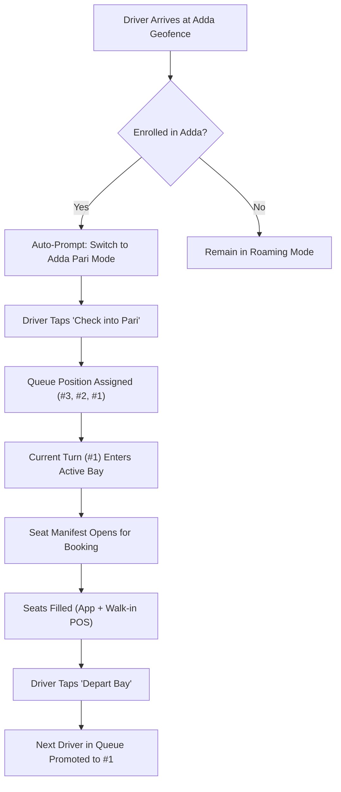

# Watan (وطن) — Multi-Modal Pricing & Pari Dispatch Model

## 1. Architectural Philosophy

Urban transportation in Pakistan operates on two distinct physical paradigms:
1. **On-Demand Doorstep Hailing (Point A to Point B):** Passenger requests a vehicle to their doorstep; driver navigates to pickup; passenger pays for the entire vehicle cabin.
2. **Adda Pari Rotational Seat Manifest (Corridor Transit):** Passenger boards at a physical stand; pays per seat; vehicle fills to capacity and departs on fixed arterial routes.

Watan unifies both models within a single real-time engine:

```
                           ┌─────────────────────────┐
                           │   PASSENGER TRIP DEMAND │
                           └────────────┬────────────┘
                                        │
                 ┌──────────────────────┴──────────────────────┐
                 ▼                                             ▼
     ┌────────────────────────┐                   ┌────────────────────────┐
     │  ON-DEMAND ROAMING     │                   │   ADDA PARI ROTATION   │
     │  (Full Vehicle Cabin)  │                   │    (Per-Seat Ticket)   │
     └───────────┬────────────┘                   └───────────┬────────────┘
                 │                                             │
                 ▼                                             ▼
       Standard Fare Matrix                         Manifest Seat Allocator
       Base + (Km × Rate)                          Per-Seat Corridor Fare
       + Waiting Fees                               + Ladies Zone Protection
```

---

## 2. Multi-Modal Fare Matrix (PKR)

Fares are calculated upfront in Pakistani Rupees (`Rs. / PKR`) based on road distance, expected transit duration, and vehicle tier:

| Vehicle Class | Base Fare (Rs.) | Rate per Km (Rs./km) | Rate per Min (Rs./min) | Minimum Fare (Rs.) | Driver Take-Rate |
|---|---|---|---|---|---|
| **Bike (موٹر سائیکل)** | Rs. 50 | Rs. 22 | Rs. 2.0 | Rs. 80 | 90% (10% Watan Fee) |
| **Auto Rickshaw (رکشہ)** | Rs. 90 | Rs. 38 | Rs. 3.0 | Rs. 140 | 90% (10% Watan Fee) |
| **Qingqi (چنگچی فی سیٹ)** | Rs. 20 / seat | Rs. 6 / km | N/A | Rs. 30 / seat | **100% (0% Watan Fee)** |
| **Car Mini (مہران / آلٹو)** | Rs. 160 | Rs. 55 | Rs. 4.5 | Rs. 220 | 90% (10% Watan Fee) |
| **Car Comfort (اے سی کار)** | Rs. 260 | Rs. 75 | Rs. 6.0 | Rs. 350 | 90% (10% Watan Fee) |
| **Wagon (ویگن سیٹ)** | Rs. 100 / seat | Rs. 14 / km | N/A | Rs. 150 / seat | **100% (0% Watan Fee)** |
| **Coaster Bus (کوسٹر بس)** | Rs. 150 / seat | Rs. 10 / km | N/A | Rs. 200 / seat | **100% (0% Watan Fee)** |

### Waiting Fee & Grace Period
- **Complimentary Grace Period:** 3 minutes upon driver marking `arrived`.
- **Waiting Rate:** Rs. 5.00 / minute thereafter.
- **Cancellation Compensation:** If a passenger cancels after 3 minutes of driver dispatch, a flat **Rs. 75 to Rs. 150** cancellation charge is credited to the driver.

---

## 3. The Pari (پاری) FIFO Queue Algorithm

The Pari queue digitizes traditional stand governance, eliminating verbal arguments between drivers and Munshis:



### Queue Rules & Integrity
1. **FIFO Strict Ordering:** Drivers cannot jump the queue. The driver who checked in first gets the next departure bay.
2. **Geofence Enforcement:** If a driver's GPS coordinates drift more than 400 meters away from the Adda without departing on an official manifest, they forfeit their turn and are pushed to the back of the queue.
3. **Turn Skipping (باری چھوٹ جانا):** If a vehicle experiencing mechanical difficulty skips its turn, the Munshi can flag it on the Stand POS tablet with one tap, advancing the immediate next vehicle.

---

## 4. Seat Manifest & Ladies Zone Logic

For shared corridor vehicles (Toyota HiAce 14-seaters, Qingqis, and Coaster buses), safety, cultural sensitivity, and cabin comfort are paramount.

### Toyota HiAce Grand Cabin Grid (14 Seats)
```
[ DRIVER ]               [ SEAT 1: Front Window ]  [ SEAT 2: Front Middle ]
───────────────────────────────────────────────────────────────────────────
ROW 2 (LADIES ZONE)  ->  [ SEAT 3: Window ]   [ SEAT 4: Mid ]   [ SEAT 5: Aisle ]
ROW 3 (GENERAL)      ->  [ SEAT 6: Window ]   [ SEAT 7: Mid ]   [ SEAT 8: Aisle ]
ROW 4 (GENERAL)      ->  [ SEAT 9: Window ]   [ SEAT 10: Mid ]  [ SEAT 11: Aisle ]
ROW 5 (BACK BENCH)   ->  [ SEAT 12: Win ]     [ SEAT 13: Mid ]  [ SEAT 14: Win ]
```

### Ladies Zone Rules
- **Row 2** is reserved for unaccompanied female passengers or women traveling with small children.
- If a male passenger attempts to book a seat in Row 2, the app alerts them:
  > *"Row 2 is designated as a protected Ladies Zone. Please select general seating in Rows 3, 4, or 5."*
- Counter Munshis can override allocation only when accommodating a unified family group.

---

## 5. Offline-Resilient Ticketing & Change Calculation

Because network connectivity in crowded Pakistani bus terminals can fluctuate:
1. **Stand POS Offline Sync:** The Munshi tablet maintains an indexed SQLite/IndexedDB store of passenger seat reservations and tickets. Even if 4G drops, the Munshi can issue tickets and verify boarding QR codes.
2. **Automated Change Dispenser:** Munshis enter the amount tendered (e.g., Rs. 1,000 cash for a Rs. 350 ticket). The screen prominently displays in large green type:
   > *"Give Change: Rs. 650"*
   This prevents mathematical errors and accelerates passenger throughput during peak Eid and weekend rushes.
